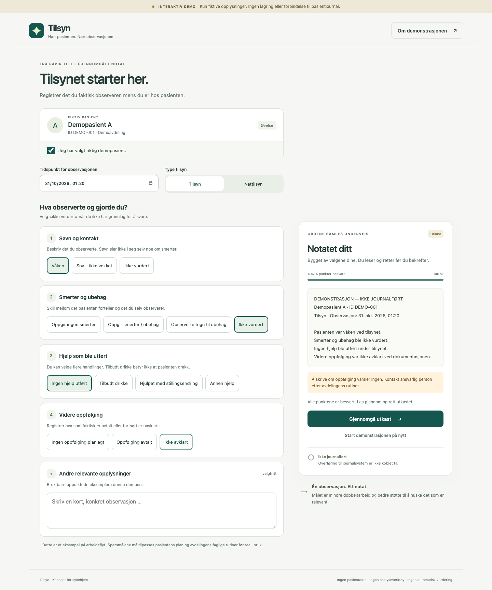
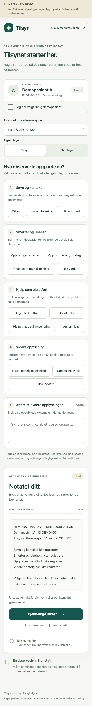

# Tilsyn – fra observasjon til notatutkast

Nettbrettvennlig prototype som gjør strukturerte observasjoner om til et redigerbart notatutkast, i stedet for en blank tekstboks.



<p align="center">
  
</p>

## Hva den gjør

Brukeren velger observasjoner fra et ferdig sett med kategorier. Prototypen setter dem sammen til et sammenhengende utkast som kan redigeres fritt før det bekreftes. Målet er å fjerne friksjonen ved å formulere seg fra null, ikke å erstatte faglige vurderinger.

- Ferdigdefinerte observasjonspunkter å velge fra
- Utkast som genereres fra valgene og kan redigeres fritt
- Gjennomgang der du bekrefter at notatet stemmer med det du gjorde
- Håndtering av motstridende svar
- Responsivt oppsett for nettbrett og mobil

## Hva den ikke gjør

Kun fiktive data. Ingen lagring, ingen innlogging, ingen AI, ingen forbindelse til pasientjournal. Ingen klinisk validering. Prototypen er en utforsking av arbeidsflyt og grensesnitt, ikke et medisinsk hjelpemiddel.

## Teknisk

| | |
|---|---|
| Språk | HTML, CSS, JavaScript (uten rammeverk) |
| Avhengigheter | Ingen |
| Byggesteg | Ingen – åpnes direkte i nettleser |

## Kom i gang

```sh
python3 -m http.server --bind 127.0.0.1 8080
```

Åpne <http://127.0.0.1:8080>, velg observasjoner, gå gjennom utkastet og bekreft.

## Testing

JavaScript-syntakskontroll er kjørt, og grensesnittet er testet i nettleser for obligatoriske svar, ubesvarte punkter, gjennomgang, bekreftelse, motstridende svar og mobilbredde. Skjermbildene er kontrollert visuelt. Detaljer i [`VERIFISERING.md`](VERIFISERING.md).

Dette er funksjonell testing av grensesnittet. Det finnes ingen klinisk validering, brukertesting eller tilgjengelighetsrevisjon.

## Lisens

MIT – se [LICENSE](LICENSE).
